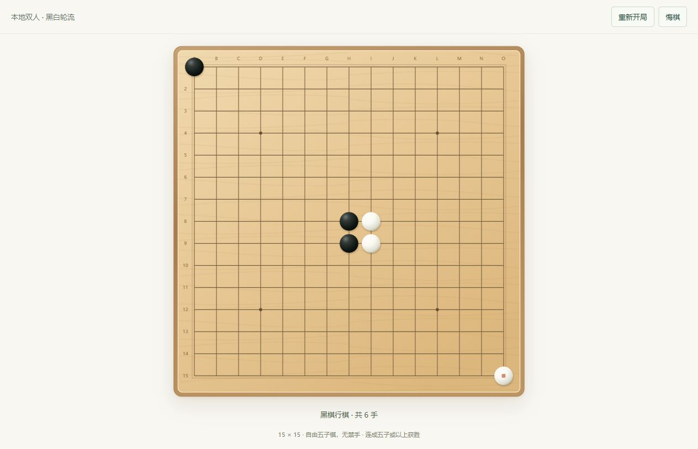

# Gomoku Friends · 五子棋

木色棋盘、立体黑白棋子、浅色界面，支持 **人机对战、好友联机、本地双人**。从桌游平台中独立整理，只包含五子棋和它需要的账号、房间服务。



## 本地启动

需要 Node.js 24 和 pnpm 10.34.9。安装包含原生 SQLite 依赖，请允许依赖构建脚本运行。

```sh
pnpm install --frozen-lockfile
```

将 `.env.example` 复制为 `.env`，然后：

```sh
pnpm db:migrate
pnpm dev
```

打开 http://localhost:5176 。后端默认仅监听本机 3006 端口。

## 三种玩法

- **人机**：游客执黑先行，电脑执白；可重新开局、悔棋。电脑优先成五或堵四，其余按局面评分；不承诺特定棋力。
- **本地双人**：共用一台设备，黑白轮流落子；每次悔棋退一手，无需账号。
- **好友**：双方各自注册/登录，房主建房并分享 10 位房间码，好友加入执白。服务器判断走法与胜负，刷新后可继续本人未结束的房间。两个账号测试请使用不同浏览器或隐私窗口，普通标签页会共用登录 Cookie。

15×15 自由五子棋，黑先，无禁手，连续五颗或更多获胜。满盘没有五连则和棋。没有计时、匹配、观战、联机悔棋、排行榜或正式积分。

好友对局以服务器为准；校验身份、轮次、位置、版本和请求编号，防止越权、重叠落子、旧请求和重复落子。SQLite 保存房间与棋局，页面约每 1.2 秒同步一次。断网不直接判负；等待房间可取消，开局后可认输。每个账号最多同时有 3 个未结束房间。

## 验证与构建

```sh
pnpm typecheck
pnpm test
pnpm test:portable
pnpm build
```

测试覆盖四方向及中间补子的五连、长连、和棋、非法落子、AI 赢棋/堵四、旧 AI 任务隔离、双人悔棋、房间权限、并发加入、幂等与版本检查、重启恢复和联机终局。

前端产物：`apps/web/dist`；后端产物：`apps/server/dist`。

## 不安装依赖也能玩

直接打开 `portable/index.html`，选择人机或本地双人。棋盘已打成单个 HTML，脚本、样式和木纹都在本地，无需 CDN。

好友联机必须运行完整后端，不能只把静态文件上传到 GitHub Pages 就获得联机功能。

修改棋盘后运行 `node tools/build-portable.mjs` 重建离线单文件。

## 自己部署

见 [部署说明](docs/deployment.md) 和 [Caddy 示例](docs/Caddyfile.example)。需设置自己的 HTTPS 域名、WEB_ORIGIN 和持久数据库位置；生产 HTTP 下账号写入及好友接口默认关闭。

此独立项目从数据库迁移 1 开始，**不要直接使用原平台数据库**。包内没有真实账号、数据库、Cookie、生产环境文件、SSH 凭据或主站服务器地址。

账号是基础用户名密码登录，不提供找回密码、邮件验证或管理后台。

## 目录

- `apps/web`：Vue 三模式页面、账号界面、原生 SVG 棋盘。
- `apps/server`：Fastify 账号/房间 API、SQLite 持久化及测试。
- `packages/game-core`：服务端复用的纯规则与 AI。
- `packages/contracts`：五子棋走法、棋局及房间类型。
- `portable`：离线版入口与单文件棋盘。

浏览器与服务端的规则源文件各有一份，测试核对两份内容一致；修改规则时请同步更新并运行检查。

## 许可

[MIT License](LICENSE)。保留原项目 HullQin/gobang 的作者署名和许可，详见 [NOTICE](NOTICE.md)。
